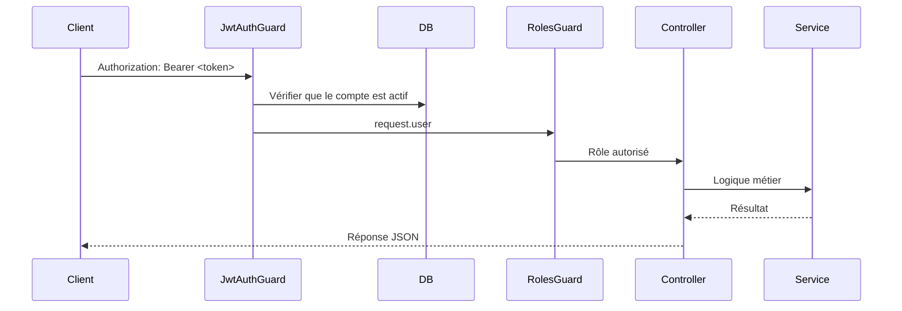

# Plateforme FabLab

> Plateforme de **réservation de salles** et de **prêt de matériel** pour FabLab.  
> API REST NestJS · MongoDB · JWT · Chatbot IA · Notifications e-mail

---

## Table des matières

1. [Structure du projet](#structure-du-projet)
2. [Prérequis](#prérequis)
3. [Installation](#installation)
4. [Configuration](#configuration)
5. [Démarrage](#démarrage)
6. [Tests](#tests)
7. [Architecture de l'API](#architecture-de-lapi)
8. [Rôles et autorisations](#rôles-et-autorisations)
9. [Routes API](#routes-api)
10. [Modules métier](#modules-métier)
11. [Jobs planifiés](#jobs-planifiés)
12. [Infrastructure](#infrastructure)
13. [Création du compte administrateur](#création-du-compte-administrateur)
14. [Guide d'intégration frontend](#guide-dintégration-frontend)
15. [Journal d'audit](#journal-daudit)

---

## Structure du projet

Monorepo **npm workspaces** :

```
plateforme-fablab/
├── apps/
│   ├── api/          # Backend — NestJS, MongoDB (Mongoose)
│   └── web/          # Frontend React (squelette)
├── packages/
│   └── shared/       # Types et constantes partagés front/back
├── infra/
│   ├── compose.yaml  # MongoDB 7 + Redis 7 (Docker Compose)
│   ├── docker/       # Dockerfiles
│   ├── nginx/        # Reverse proxy
│   └── deploy/       # Scripts de déploiement
├── docs/             # Documentation fonctionnelle par module
├── .env.example      # Modèle de configuration
└── package.json      # Racine du monorepo
```

---

## Prérequis

| Outil | Version minimale |
|-------|-----------------|
| **Node.js** | >= 20 (voir `.nvmrc`) |
| **npm** | >= 9 |
| **MongoDB** | 7 (local ou distant) |
| **Redis** | 7 (optionnel — verrou des jobs planifiés) |
| **Docker** | Recommandé pour MongoDB + Redis en local |

---

## Installation

```bash
# Depuis la racine du monorepo — installe toutes les dépendances (api, web, shared)
npm install
```

---

## Configuration

Copier le modèle d'environnement et renseigner les valeurs :

```bash
cp .env.example .env
```

| Variable | Obligatoire | Défaut | Description |
|----------|:-----------:|--------|-------------|
| `NODE_ENV` | Non | `development` | Environnement (`development` / `production`) |
| `PORT` | Non | `3000` | Port HTTP de l'API |
| `MONGODB_URI` | **Oui** | `mongodb://localhost:27017/fablab` | URI de connexion MongoDB |
| `JWT_SECRET` | **Oui** | — | Secret de signature des jetons JWT (chaîne longue et aléatoire) |
| `JWT_EXPIRES_IN` | Non | `8h` | Durée de vie d'un jeton JWT |
| `REDIS_URL` | Non | — | URL Redis — verrou des jobs planifiés (sans Redis, les jobs sont sautés) |
| `AI_API_KEY` | Non | — | Clé API Anthropic — active le chatbot IA (sans clé : réponses par règles) |
| `AI_MODEL` | Non | `claude-haiku-5-5` | Modèle Anthropic utilisé par le chatbot |
| `SMTP_HOST` | Non | — | Hôte SMTP pour les notifications e-mail |
| `SMTP_USER` | Non | — | Utilisateur SMTP |
| `SMTP_PASS` | Non | — | Mot de passe SMTP |
| `MAIL_FROM` | Non | — | Adresse d'expédition des e-mails |
| `LOAN_MAX_DAYS` | Non | `14` | Durée maximale d'un prêt (jours) |

> [!CAUTION]
> Ne jamais committer `.env` ni aucune valeur secrète.  
> `JWT_SECRET` doit être différent par environnement.

---

## Démarrage

```bash
# 1. Lancer MongoDB et Redis (Docker)
docker compose -f infra/compose.yaml up -d

# 2. Créer le compte administrateur (première fois)
ADMIN_EMAIL=admin@example.org ADMIN_PASSWORD='<mot-de-passe-fort>' \
  node apps/api/scripts/seed-admin.js

# 3. Démarrer l'API en mode développement (watch)
npm run start:dev

# L'API répond sur http://localhost:3000/api
```

```bash
# Mode production
npm run build
npm run start:prod --workspace @fablab/api
```

> [!NOTE]
> L'API est exposée sous le préfixe global `/api`.  
> `GET http://localhost:3000/api/health` retourne l'état de l'API et de la connexion MongoDB.

---

## Tests

Les tests unitaires utilisent le runner natif **`node:test`** de Node.js — aucun framework externe.

```bash
# Depuis la racine — exécute tous les fichiers *.test.ts de apps/api
npm test

# Équivalent explicite
npm run test --workspace @fablab/api
```

```
ℹ tests 108
ℹ pass  107
ℹ fail    0
```

> [!TIP]
> Les tests s'exécutent via `ts-node` et utilisent `apps/api/tsconfig.json`.  
> Chaque module dispose de son propre `*.test.ts` testant le service en isolation
> avec des mocks — aucune base de données réelle n'est requise.

---

## Architecture de l'API

```
apps/api/src/
├── common/
│   ├── decorators/   # @Public(), @Roles(), @CurrentUser()
│   ├── enums/        # UserRole
│   ├── filters/      # HttpExceptionFilter (format d'erreur uniforme)
│   └── guards/       # JwtAuthGuard (global), RolesGuard (global)
├── database/         # Connexion Mongoose
├── health/           # GET /api/health
├── jobs/             # Jobs planifiés (LoanOverdueJob, LoanReminderJob)
└── modules/
    ├── admin/        ├── audit/        ├── auth/
    ├── availability/ ├── chatbot/      ├── collaboration/
    ├── files/        ├── loans/        ├── locations/
    ├── notifications/├── organizations/├── reservations/
    ├── resources/    └── users/
```

**Flux d'une requête :**



---

## Rôles et autorisations

| Rôle | Création | Accès |
|------|----------|-------|
| `Utilisateur` | Défaut à l'inscription | Ses propres ressources (prêts, profil, notifications) |
| `Responsable` | Attribué par un Admin | Gestion des ressources, réservations, retours de prêts |
| `Administrateur` | Seed ou Admin | Tout — comptes, rôles, paramètres, journal d'audit |

**Mécanismes de sécurité :**

- Authentification par **JWT** (`Authorization: Bearer <token>`), vérification en base à chaque requête que le compte est actif.
- `JwtAuthGuard` et `RolesGuard` appliqués **globalement** ; les routes publiques sont décorées `@Public()`.
- Mots de passe hachés avec **bcrypt**, jamais exposés par l'API.
- Toutes les entrées validées (`class-validator` + `ValidationPipe` global).
- Format d'erreur uniforme : `{ statusCode, message, error, path, timestamp }`.

> [!IMPORTANT]
> **Déconnexion** : `POST /api/auth/logout` journalise l'action mais **ne révoque pas le JWT**.
> Le token reste valide jusqu'à son expiration (`JWT_EXPIRES_IN`).
> Il n'existe pas encore de blacklist ni de session serveur.

---

## Routes API

### Authentification & Profil

| Méthode | Route | Accès | Description |
|---------|-------|-------|-------------|
| GET | `/api/health` | Public | État de l'API et de MongoDB |
| POST | `/api/auth/login` | Public | Connexion → `{ accessToken, tokenType, user }` |
| POST | `/api/auth/logout` | Authentifié | Déconnexion (journalisée) |
| GET | `/api/me` | Authentifié | Profil de l'utilisateur connecté |

### Utilisateurs

| Méthode | Route | Accès | Description |
|---------|-------|-------|-------------|
| GET | `/api/users` | Administrateur | Liste paginée des utilisateurs |
| POST | `/api/users` | Administrateur | Créer un compte |
| GET | `/api/users/:id` | Administrateur | Détail d'un utilisateur |
| GET | `/api/users/me` | Authentifié | Son propre profil |
| PATCH | `/api/users/me` | Authentifié | Modifier son profil (nom, téléphone…) |
| PATCH | `/api/users/me/password` | Authentifié | Changer son mot de passe |
| PATCH | `/api/users/:id` | Administrateur | Modifier rôle, activation, profil |

### Ressources (salles & équipements)

| Méthode | Route | Accès | Description |
|---------|-------|-------|-------------|
| GET | `/api/resources` | Authentifié | Liste des ressources (avec filtres) |
| GET | `/api/resources/:id` | Authentifié | Détail d'une ressource |
| POST | `/api/resources/rooms` | Responsable, Admin | Créer une salle |
| POST | `/api/resources/equipments` | Responsable, Admin | Créer un équipement |
| PATCH | `/api/resources/:id` | Responsable, Admin | Modifier une ressource |
| DELETE | `/api/resources/:id` | Responsable, Admin | Supprimer une ressource |

### Prêts de matériel

| Méthode | Route | Accès | Description |
|---------|-------|-------|-------------|
| GET | `/api/loans` | Authentifié | Liste des prêts (un utilisateur ne voit que les siens) |
| POST | `/api/loans` | Authentifié | Créer un prêt |
| POST | `/api/loans/:id/return` | Responsable, Admin | Enregistrer le retour |

> Paramètres `GET /api/loans` : `page` (défaut `1`), `limit` (défaut `20`), `status` (`ACTIVE` / `RETURNED` / `OVERDUE`), `equipmentId`.

### Notifications

| Méthode | Route | Accès | Description |
|---------|-------|-------|-------------|
| GET | `/api/notifications` | Authentifié | Notifications de l'utilisateur (`page`, `limit`, `unreadOnly`) |

### Chatbot

| Méthode | Route | Accès | Description |
|---------|-------|-------|-------------|
| POST | `/api/chatbot/message` | Authentifié | Envoyer un message (`{ message }`, 1–500 caractères, max 10/minute) |

### Administration

| Méthode | Route | Accès | Description |
|---------|-------|-------|-------------|
| GET | `/api/audit-logs` | Administrateur | Journal des actions (filtres, pagination) |
| GET | `/api/admin/stats` | Administrateur | Statistiques de la plateforme |
| GET | `/api/admin/settings` | Administrateur | Paramètres de configuration |
| PUT | `/api/admin/settings` | Administrateur | Mettre à jour les paramètres |

### Divers

| Méthode | Route | Accès | Description |
|---------|-------|-------|-------------|
| POST | `/api/files/upload` | Responsable, Admin | Upload d'un fichier (multipart) |
| GET | `/api/organizations` | Authentifié | Liste des organisations |
| GET | `/api/organizations/:id` | Authentifié | Détail d'une organisation |
| POST | `/api/organizations` | Administrateur | Créer une organisation |

> [!NOTE]
> **Routes pas encore exposées** : `reservations`, `availability`, `locations` et `collaboration` ont leur logique métier (services, modèles, tests) mais **aucun contrôleur** pour l'instant — aucune route HTTP accessible depuis le front.

### Exemples curl

```bash
# Connexion
curl -X POST http://localhost:3000/api/auth/login \
  -H "Content-Type: application/json" \
  -d '{"email":"admin@example.org","password":"<mot-de-passe>"}'

# Récupérer son profil
curl http://localhost:3000/api/me \
  -H "Authorization: Bearer <accessToken>"

# Vérifier l'état de l'API
curl http://localhost:3000/api/health

# Lister les ressources
curl http://localhost:3000/api/resources \
  -H "Authorization: Bearer <accessToken>"
```

---

## Modules métier

| Module | Rôle | Tests |
|--------|------|-------|
| `auth` | Connexion JWT, session, gardes | ✅ |
| `users` | Comptes, profils, changement de mot de passe | ✅ |
| `admin` | Statistiques, paramètres de la plateforme | ✅ |
| `audit` | Journal des actions sensibles (`auditLogs`) | ✅ |
| `resources` | Salles et équipements (modèle Mongoose discriminé) | ✅ |
| `reservations` | Réservation de salles et équipements | ✅ |
| `availability` | Disponibilités et créneaux | ✅ |
| `loans` | Prêts de matériel (durée max via `LOAN_MAX_DAYS`) | ✅ |
| `locations` | Sites et localisation des ressources | ✅ |
| `organizations` | Organisations / structures utilisatrices | ✅ |
| `files` | Upload de fichiers (Multer) et métadonnées | ✅ |
| `notifications` | Notifications in-app et e-mail (SMTP) | ✅ |
| `chatbot` | Assistant conversationnel (IA Anthropic ou règles) | ✅ |
| `collaboration` | Annonces et messagerie par ressource | ✅ |

Chaque module suit la structure standard NestJS :
`*.module.ts` · `*.controller.ts` · `*.service.ts` · `*.model.ts` · `*.validation.ts` · `*.test.ts`

### Chatbot

Le chatbot fonctionne en deux modes :

- **Mode IA** (`AI_API_KEY` présente) : les messages sont enrichis du contexte (ressources trouvées, FAQ) puis envoyés au modèle Anthropic.
- **Mode règles** (par défaut, sans clé) : correspondance FAQ + extraction d'intention + recherche de ressources.

Le chatbot **ne réserve jamais** — il propose d'ouvrir le formulaire de réservation ; la confirmation est toujours côté utilisateur. Limite : 10 messages par minute par utilisateur (HTTP 429 au-delà).

---

## Jobs planifiés

| Job | Fréquence | Rôle |
|-----|-----------|------|
| `LoanOverdueJob` | Toutes les heures | Passe les prêts échus en `OVERDUE` et notifie l'emprunteur (une seule notification par 24 h) |
| `LoanReminderJob` | Toutes les heures | Envoie un rappel `LOAN_REMINDER` pour les prêts dont le retour est prévu dans les 48 h |

Les jobs utilisent **Redis** comme verrou distribué (`RedisLockService`) : si Redis est indisponible, le job est sauté (aucune exception propagée).

---

## Infrastructure

```bash
# Démarrer MongoDB 7 et Redis 7 en local
docker compose -f infra/compose.yaml up -d

# Arrêter
docker compose -f infra/compose.yaml down
```

Le volume `mongo_data` persiste les données entre les redémarrages.

```
infra/
├── compose.yaml     # MongoDB 7 (port 27017) + Redis 7 (port 6379)
├── docker/          # Dockerfiles de l'API et du frontend
├── nginx/           # Configuration du reverse proxy
└── deploy/          # Scripts de déploiement
```

---

## Création du compte administrateur

Un script de seed crée le **premier** compte `Administrateur` (idempotent) :

```bash
ADMIN_EMAIL=admin@example.org \
ADMIN_PASSWORD='<mot-de-passe-fort>' \
ADMIN_FIRST_NAME='Prénom' \
ADMIN_LAST_NAME='Nom' \
  node apps/api/scripts/seed-admin.js
```

| Variable | Description |
|----------|-------------|
| `ADMIN_EMAIL` | Adresse e-mail du compte |
| `ADMIN_PASSWORD` | Mot de passe initial |
| `ADMIN_FIRST_NAME` | Prénom |
| `ADMIN_LAST_NAME` | Nom |

> [!CAUTION]
> Choisir un mot de passe long et unique. Le changer après la première connexion.
> Ne jamais committer ces valeurs.

---

## Guide d'intégration frontend

> [!NOTE]
> Le back doit tourner en local avant de démarrer le front. Voir la section [Démarrage](#démarrage) plus haut.

### 1. Configurer l'URL de l'API

Dans `apps/web/.env`, déclarer l'URL de l'API selon l'outil de build :

| Outil de build | Variable `.env` | Lecture dans le code |
|---------------|-----------------|----------------------|
| Vite | `VITE_API_URL=http://localhost:3000/api` | `import.meta.env.VITE_API_URL` |
| Create React App | `REACT_APP_API_URL=http://localhost:3000/api` | `process.env.REACT_APP_API_URL` |
| Next.js | `NEXT_PUBLIC_API_URL=http://localhost:3000/api` | `process.env.NEXT_PUBLIC_API_URL` |

> Le CORS est ouvert à toutes les origines en développement (`enableCors()`).  
> Pour éviter les problèmes de CORS sans configuration serveur, utiliser un proxy :
> `server.proxy` dans `vite.config.ts` ou `"proxy": "http://localhost:3000"` dans le `package.json` CRA.

### 2. Client HTTP recommandé

Créer un client unique (ex. `apps/web/src/lib/api.ts`) qui ajoute le token à chaque requête et centralise la gestion des erreurs :

```ts
const API = import.meta.env.VITE_API_URL; // adapter selon l'outil de build

export async function api<T>(path: string, options: RequestInit = {}): Promise<T> {
  const token = localStorage.getItem('accessToken');
  const res = await fetch(`${API}${path}`, {
    ...options,
    headers: {
      'Content-Type': 'application/json',
      ...(token ? { Authorization: `Bearer ${token}` } : {}),
      ...options.headers,
    },
  });

  if (res.status === 401) {
    localStorage.removeItem('accessToken');
    window.location.href = '/login';
    return undefined as never; // interrompt l'exécution, le redirect est en cours
  }

  if (!res.ok) {
    // Corps vide possible sur certains codes → fallback sur un objet minimal
    const body = await res.text();
    throw body ? JSON.parse(body) : { statusCode: res.status, message: res.statusText };
  }

  return res.json();
}
```

> [!NOTE]
> Pour l'upload (`/api/files/upload`), passer un `FormData` et **ne pas** fixer `Content-Type` — le navigateur ajoute lui-même la limite multipart. Supprimer le header `Content-Type` des options dans ce cas.

> [!WARNING]
> `localStorage` est lisible par tout script JS de la page (vulnérable aux XSS).
> En production, préférer un **cookie `HttpOnly`** géré côté serveur pour stocker le token — le navigateur l'envoie automatiquement et JavaScript ne peut pas le lire.

### 3. S'authentifier

```ts
// 1. Login — utiliser le client défini ci-dessus
const { accessToken, user } = await api<{ accessToken: string; user: User }>('/auth/login', {
  method: 'POST',
  body: JSON.stringify({ email, password }),
});

// 2. Stocker le token
localStorage.setItem('accessToken', accessToken);

// 3. Récupérer le profil + rôle pour adapter l'interface
const me = await api<User>('/me');
```

Le token expire après `JWT_EXPIRES_IN` (8 h par défaut). Sur une réponse `401`, le client redirige automatiquement vers `/login`. La déconnexion supprime le token côté front (`localStorage.removeItem`) — le back ne le révoque pas (voir [Rôles et autorisations](#rôles-et-autorisations)).

### 4. Règles à respecter

- **Données strictes** : l'API refuse `400` tout champ inconnu dans le corps d'une requête. N'envoyer que les champs documentés.
- **Pagination** : `page` (défaut `1`) et `limit` (défaut `20`) sur les listes d'utilisateurs, prêts, notifications et journal d'audit.
- **Format d'erreur** : `{ statusCode, message, error, path, timestamp }`. `message` peut être un tableau de chaînes si plusieurs champs sont invalides.
- **Codes HTTP à gérer** :

| Code | Signification |
|------|---------------|
| `400` | Données invalides (champ manquant, format incorrect…) |
| `401` | Non connecté ou token expiré → rediriger vers login |
| `403` | Rôle insuffisant → masquer l'action dans l'UI |
| `404` | Ressource introuvable |
| `409` | Conflit (ex. prêt déjà retourné, e-mail déjà utilisé) |
| `429` | Limite de débit chatbot dépassée (10 messages/minute) |

- **Rôles** : vérifier `user.role` pour afficher/masquer les actions dans l'interface, mais ne pas s'y fier pour la sécurité — l'API vérifie toujours le rôle côté serveur.
- **Types partagés** : utiliser `import { ... } from '@fablab/shared'` plutôt que de redéfinir les enums et constantes.
- **Chatbot** : lire le champ `suggestedAction` de la réponse pour proposer l'ouverture du formulaire de réservation. Ne jamais appeler `POST /api/reservations` directement depuis le chatbot — la confirmation passe toujours par l'utilisateur.

---

## Journal d'audit

La collection MongoDB `auditLogs` enregistre automatiquement les actions sensibles :

| Action | Déclencheur |
|--------|-------------|
| `auth.login` | Connexion réussie |
| `auth.login_failed` | Échec de connexion |
| `auth.logout` | Déconnexion |
| `user.created` | Création d'un compte |
| `user.updated` | Modification d'un compte |
| `user.password_changed` | Changement de mot de passe |
| `settings.updated` | Mise à jour des paramètres |
| `loan.created` | Création d'un prêt |
| `loan.returned` | Retour d'un prêt |

Chaque entrée contient : `userId`, `action`, `resourceType`, `resourceId`, `details`, `ip`.

Consultation : `GET /api/audit-logs` (Administrateur uniquement), avec `page`, `limit` et filtre `action`.
